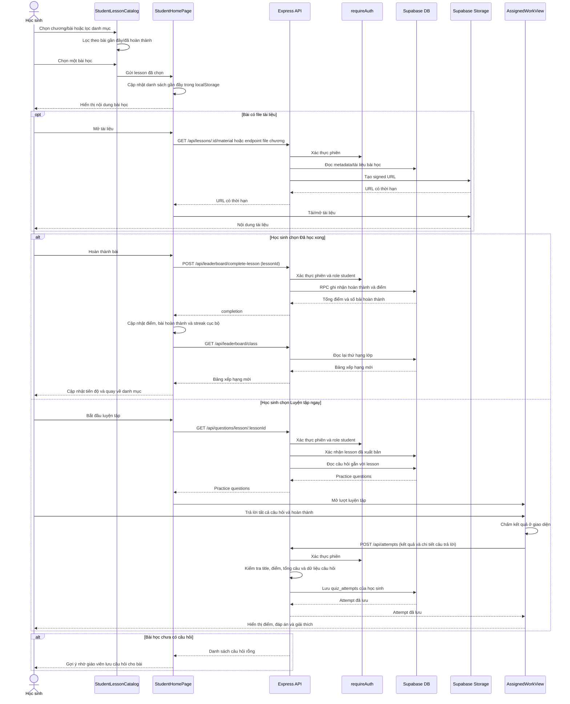
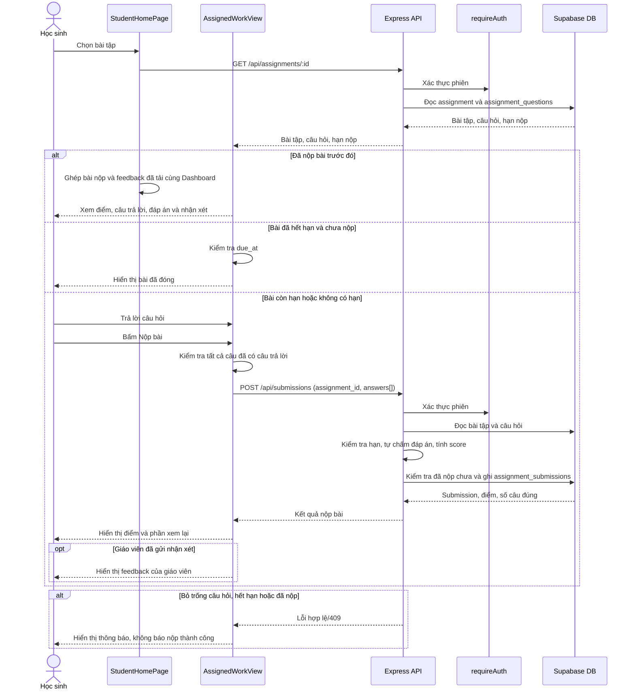
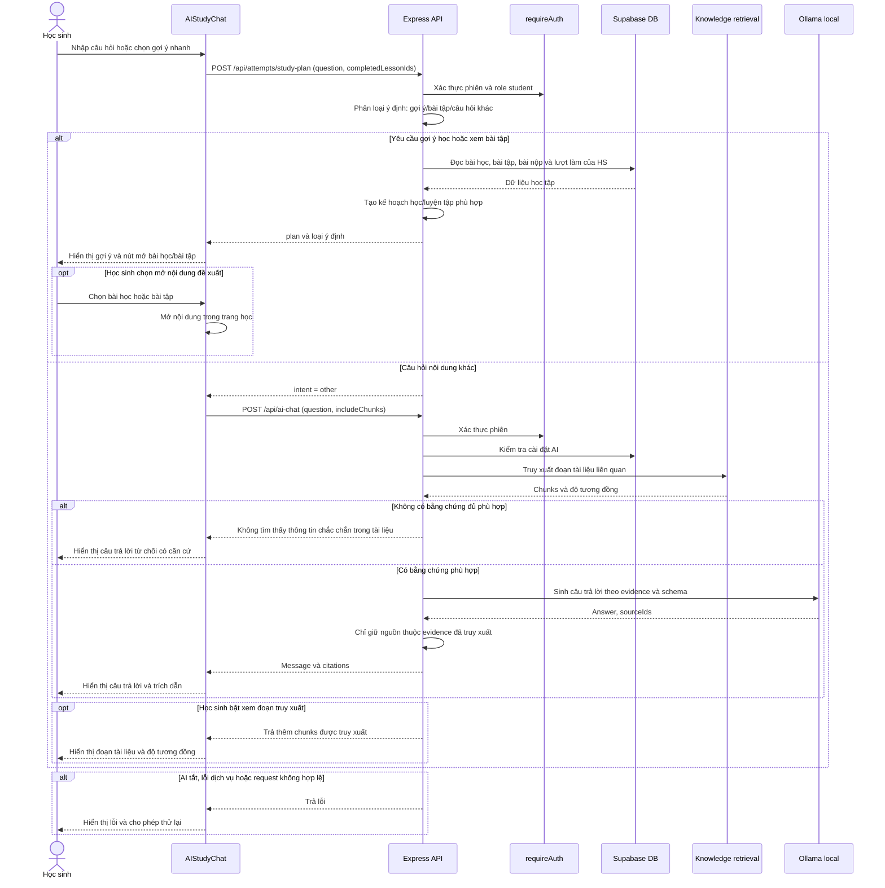
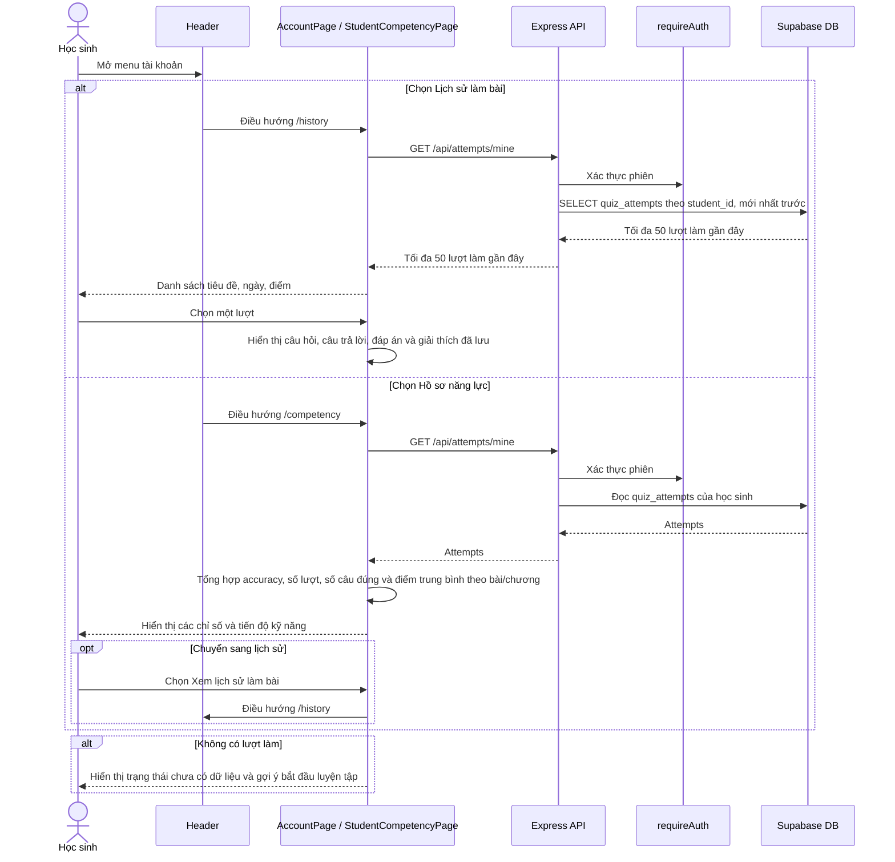
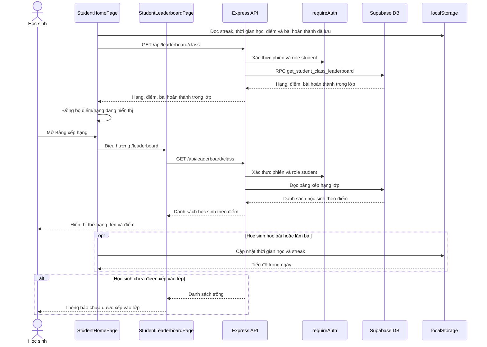
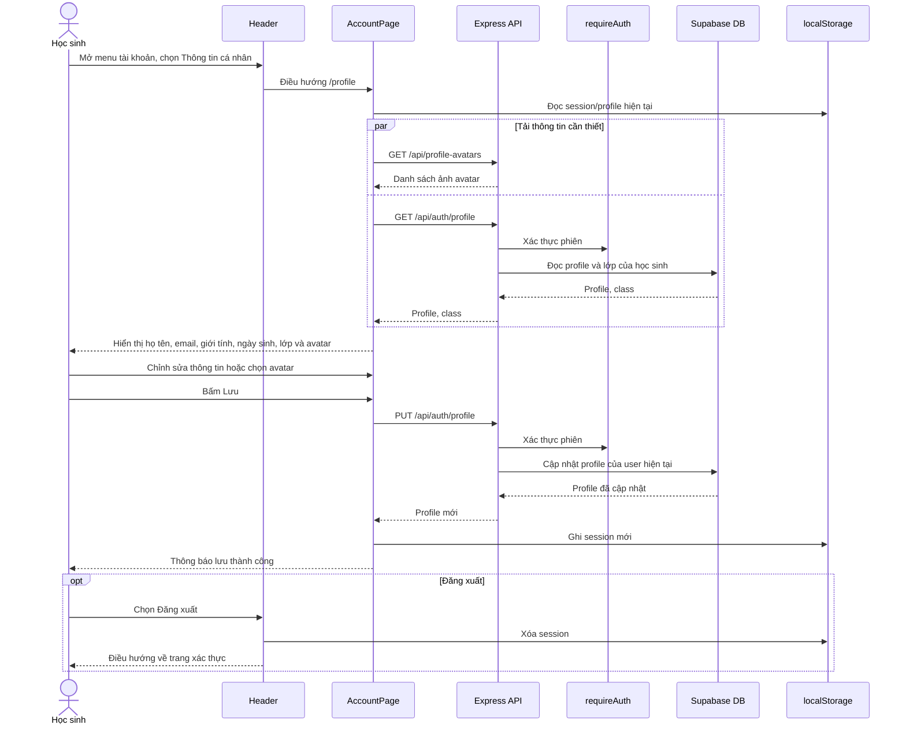

# Sequence diagram các chức năng học sinh

Tài liệu mô tả các luồng học sinh hiện có trong ứng dụng, từ giao diện React qua API Express tới Supabase và Ollama. Sơ đồ dùng Mermaid; có thể xem trực tiếp trên GitHub hoặc VS Code có hỗ trợ Mermaid.

## Phạm vi và vai trò

- Học sinh dùng trang học tập để xem bài học đã xuất bản, làm bài tập được giao, luyện tập câu hỏi theo bài học, hỏi trợ lý, xem bảng xếp hạng, hồ sơ năng lực và lịch sử làm bài, cập nhật hồ sơ và chơi game Bắn Thiên Thạch.
- Các trang `/leaderboard`, `/competency` và `/meteor-game` giới hạn cho role `student`. Các API xác thực phiên đăng nhập; một số API kiểm tra role học sinh rõ ràng.
- Dashboard, danh sách bài học đã xem gần đây, bài học đã hoàn thành dùng để lọc, chuỗi ngày học và thời gian học hằng ngày có phần được lưu ở `localStorage`. Điểm/lượt hoàn thành, bài nộp và lượt luyện tập có API và được lưu trên server.
- Game nhận câu hỏi của các bài học đã hoàn thành, nhưng điểm game/kết quả chơi không được gửi lên API trong luồng hiện tại.

## 1. Đăng nhập và tải trang học tập

Trang ứng dụng đọc phiên đăng nhập ở trình duyệt; nếu chưa có token sẽ chuyển về trang xác thực. Sau khi vào trang học sinh, giao diện tải bài học, bài tập, bài nộp và bảng xếp hạng lớp.

```mermaid
sequenceDiagram
    actor HS as Học sinh
    participant App as App / AuthPage
    participant API as Express API
    participant Auth as requireAuth
    participant DB as Supabase
    participant Home as StudentHomePage

    HS->>App: Mở trang học tập
    App->>App: Đọc session và role
    alt Chưa có access token
        App-->>HS: Hiển thị trang đăng nhập/đăng ký
        HS->>App: Đăng nhập hoặc đăng ký học sinh
        App->>API: POST /api/auth/login hoặc /api/auth/register
        API->>DB: Xác thực hoặc tạo tài khoản
        DB-->>API: User và phiên đăng nhập
        API-->>App: Session/profile
        App->>App: Lưu session ở trình duyệt
    else Đã có phiên
        App->>App: Kiểm tra role từ profile
    end
    App->>Home: Hiển thị trang học sinh
    par Tải nội dung học tập
        Home->>API: GET /api/lessons/published
        API->>Auth: Xác thực phiên
        API->>DB: Đọc bài học đã xuất bản
        DB-->>API: Lessons
        API-->>Home: Lessons
    and
        Home->>API: GET /api/assignments/published
        API->>Auth: Xác thực phiên
        API->>DB: Đọc bài tập đã xuất bản, theo quyền truy cập
        DB-->>API: Assignments
        API-->>Home: Assignments
    and
        Home->>API: GET /api/submissions/mine
        API->>Auth: Xác thực phiên
        API->>DB: Đọc bài nộp của học sinh hiện tại
        DB-->>API: Submissions và nhận xét
        API-->>Home: Submissions và nhận xét
    and
        Home->>API: GET /api/leaderboard/class
        API->>Auth: Xác thực phiên và role student
        API->>DB: Đọc bảng xếp hạng lớp
        DB-->>API: Leaderboard
        API-->>Home: Leaderboard
    end
    Home->>Home: Ghép bài tập với bài nộp; đọc tiến độ cục bộ
    Home-->>HS: Hiển thị bài học, bài tập, điểm và mục tiêu ngày
    alt Tải dữ liệu thất bại
        API-->>Home: Lỗi API
        Home-->>HS: Hiển thị trạng thái lỗi
    end
```

## 2. Xem bài học, luyện tập và ghi nhận hoàn thành

Danh mục chỉ tải bài học đã xuất bản. Học sinh có thể xem theo chương/bài, lọc bài đã học gần đây hoặc hoàn thành. Tài liệu gắn với bài học có thể được mở bằng signed URL. Luyện tập tải câu hỏi đã được giáo viên lưu trong ngân hàng cho bài học đó.



## 3. Làm bài tập được giao, nộp và xem lại

Học sinh mở bài tập từ danh sách. Bài tập chưa hết hạn cho phép trả lời và nộp; client yêu cầu trả lời đủ câu. Server tải bài tập, tự chấm, lưu bài nộp. Bài đã nộp có thể mở để xem lại đáp án/nhận xét; bài đã quá hạn chưa nộp bị khóa.



## 4. Hỏi trợ lý học tập

Trợ lý phân loại câu hỏi trước. Nếu là câu hỏi gợi ý học bài/bài tập, server tạo kế hoạch từ bài học, bài tập, lượt làm và tiến độ đã hoàn thành. Nếu không thuộc nhóm đó, giao diện gửi tiếp đến chat hỏi đáp dựa trên tài liệu đã truy xuất. Câu trả lời kiến thức có trích dẫn nguồn; nếu không tìm thấy bằng chứng phù hợp, trợ lý từ chối trả lời chắc chắn.



## 5. Xem lịch sử làm bài và hồ sơ năng lực

Mỗi lượt luyện tập từ câu hỏi ngân hàng được lưu vào `quiz_attempts`. Trang lịch sử đọc các lượt làm gần đây và cho mở chi tiết từng câu. Hồ sơ năng lực tổng hợp điểm và độ chính xác theo bài/chương từ cùng dữ liệu.



## 6. Xem bảng xếp hạng và điểm tiến độ

Bảng xếp hạng được tính theo lớp bằng RPC. Điểm và số bài hoàn thành lấy từ dữ liệu server; trang học còn hiển thị streak và thời gian học ngày hiện tại dựa trên localStorage.



## 7. Chơi game Bắn Thiên Thạch

Trước khi mở game, trang tải danh sách bài học đã xuất bản, lọc các bài có id trong danh sách hoàn thành ở localStorage, rồi lấy câu hỏi luyện tập của từng bài. Câu hỏi được chuyển vào iframe qua `postMessage`. Game hiện dùng bộ câu hỏi mẫu khi không có câu hỏi từ bài đã học.

```mermaid
sequenceDiagram
    actor HS as Học sinh
    participant Home as StudentHomePage
    participant UI as MeteorGamePage
    participant API as Express API
    participant Auth as requireAuth
    participant DB as Supabase DB
    participant Game as meteor-game.html iframe

    HS->>Home: Chọn Bắn Thiên Thạch
    Home->>UI: Điều hướng /meteor-game
    UI->>UI: Đọc danh sách bài hoàn thành từ localStorage
    UI->>API: GET /api/lessons/published
    API->>Auth: Xác thực phiên
    API->>DB: Đọc bài học đã xuất bản
    DB-->>API: Lessons
    API-->>UI: Lessons
    UI->>UI: Lọc bài đã hoàn thành
    loop Mỗi bài đã hoàn thành
        UI->>API: GET /api/questions/lesson/:lessonId
        API->>Auth: Xác thực phiên và role student
        API->>DB: Xác nhận bài học đã xuất bản và đọc câu hỏi
        DB-->>API: Câu hỏi luyện tập của bài
        API-->>UI: Câu hỏi luyện tập của bài
    end
    UI->>UI: Chuyển câu hỏi thành format game
    UI->>Game: postMessage smart-learning:meteor-questions
    Game->>Game: Nạp câu hỏi; dùng bộ mẫu nếu không có câu phù hợp
    Game-->>HS: Hiển thị trò chơi
    opt Thiếu câu hỏi hoặc có lỗi tải
        UI-->>HS: Thông báo game đang dùng câu hỏi mẫu
    end
    Note over Game,DB: Điểm và kết quả game không được gửi lên API trong luồng hiện tại.
```

## 8. Xem/cập nhật thông tin cá nhân và đăng xuất

Thông tin profile được đọc từ session; trang thông tin cá nhân tải danh sách avatar và thông tin lớp. Khi lưu, server cập nhật hồ sơ và frontend thay session đã lưu.



## Ghi chú dữ liệu và giới hạn hiện tại

- Luyện tập câu hỏi ngân hàng lưu lịch sử qua `POST /api/attempts`; bài tập được giao lưu bài nộp qua `POST /api/submissions`. Đây là hai loại dữ liệu kết quả riêng.
- Bài tập nộp được chấm ở server; lượt luyện tập ngân hàng được chấm trên giao diện trước khi gửi kết quả và chi tiết câu trả lời lên server.
- Học sinh chỉ lấy câu luyện tập cho lesson đã xuất bản qua `GET /api/questions/lesson/:lessonId`.
- Hồ sơ năng lực và lịch sử đọc cùng nguồn `quiz_attempts`; giao diện hồ sơ tính tổng hợp ở client.
- Mục tiêu 15 phút/ngày, thời gian học, streak, bài học gần đây và bộ lọc đã hoàn thành có phần lưu cục bộ theo trình duyệt; không tự đồng bộ giữa thiết bị.
- Game dùng câu hỏi từ bài đã hoàn thành, nhưng điểm game chưa được lưu vào hồ sơ hoặc bảng xếp hạng.

## Bảng API học sinh liên quan

| Chức năng | API chính | Mục đích |
|---|---|---|
| Đăng nhập/đăng ký | `POST /api/auth/login`, `POST /api/auth/register` | Tạo phiên học sinh |
| Bài học | `GET /api/lessons/published` | Danh mục bài học đã xuất bản |
| File bài học | `GET /api/lessons/:id/material`, `GET /api/lessons/storage-chapters/:bucket/file-url` | Lấy signed URL cho tài liệu |
| Câu luyện tập | `GET /api/questions/lesson/:lessonId` | Lấy câu hỏi ngân hàng của bài học |
| Lượt luyện tập | `POST /api/attempts`, `GET /api/attempts/mine` | Lưu và đọc lịch sử luyện tập |
| Bài tập được giao | `GET /api/assignments/published`, `GET /api/assignments/:id` | Đọc bài tập/câu hỏi |
| Nộp bài tập | `POST /api/submissions`, `GET /api/submissions/mine` | Nộp bài, xem điểm và feedback |
| Hoàn thành bài/leaderboard | `POST /api/leaderboard/complete-lesson`, `GET /api/leaderboard/class` | Ghi nhận điểm bài học và xem hạng lớp |
| Trợ lý gợi ý | `POST /api/attempts/study-plan` | Tạo gợi ý dựa trên dữ liệu học tập |
| Hỏi đáp tài liệu | `POST /api/ai-chat` | Trả lời có căn cứ từ tài liệu truy xuất |
| Hồ sơ | `GET /api/auth/profile`, `PUT /api/auth/profile`, `GET /api/profile-avatars` | Xem và cập nhật profile/avatar |
